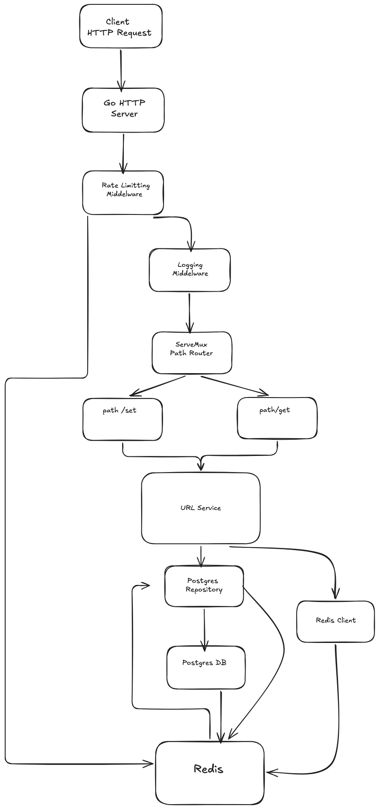

# Shortify

Shortify is a URL-shortening service written in Go. It accepts a long HTTP or HTTPS URL, stores a short-code mapping in PostgreSQL, and redirects visitors to the original URL. Redis is used for URL caching and per-IP rate limiting.

## How It Works

A `POST /set` request validates the submitted URL. The service reuses an existing code for duplicate URLs or generates a random eight-character Base62 code and stores the mapping in PostgreSQL. Redis caches the mapping for later lookups.

When a visitor requests `GET /{code}`, the service checks Redis first and falls back to PostgreSQL on a cache miss. The server responds with a `302 Found` redirect to the original URL. Redis also tracks request counts for rate limiting; the current limit is 10 requests per IP per minute.

## Requirements

- Go 1.25.6 or later
- PostgreSQL
- Redis

## Local Setup

1. Copy `.env.example` to `.env` and set `DB_USER`, `DB_NAME`, `DB_HOST`, `DB_PORT`, and `DB_SSLMODE` for your PostgreSQL instance.
2. Create the URL table with the unique constraints used by the repository:

   ```sql
   CREATE TABLE urls (
       id BIGSERIAL PRIMARY KEY,
       short_code TEXT NOT NULL CONSTRAINT urls_short_code_key UNIQUE,
       long_url TEXT NOT NULL CONSTRAINT unique_long_url UNIQUE
   );
   ```

3. Start PostgreSQL and Redis, then run the service:

   ```sh
   go run ./cmd
   ```

The HTTP server listens on port `8080`. Redis is currently configured at `localhost:6379`.

## API

Create a short URL:

```sh
curl -X POST http://localhost:8080/set \
  -H 'Content-Type: application/json' \
  -d '{"url":"https://example.com/products?color=white"}'
```

The response contains a `short_url`, such as `http://localhost:8080/7K33xWmI`.

Open or request the returned short URL to be redirected to the original destination:

```sh
curl -i http://localhost:8080/7K33xWmI
```

The current redirect route is `GET /{code}`. The diagram's `/get` label is not the route used by the current router.

Run the tests with:

```sh
go test ./...
```

## Architecture Diagram


